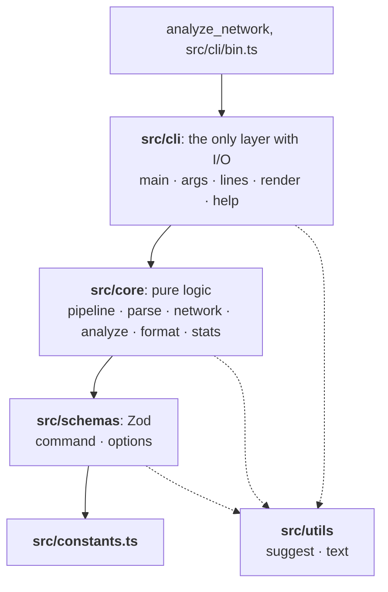
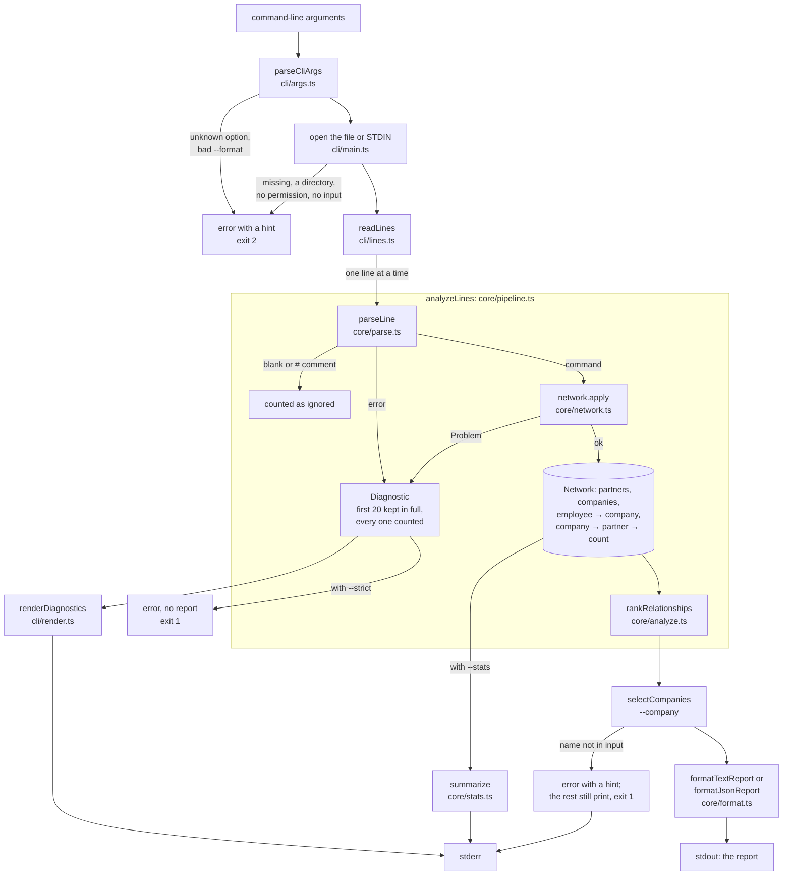
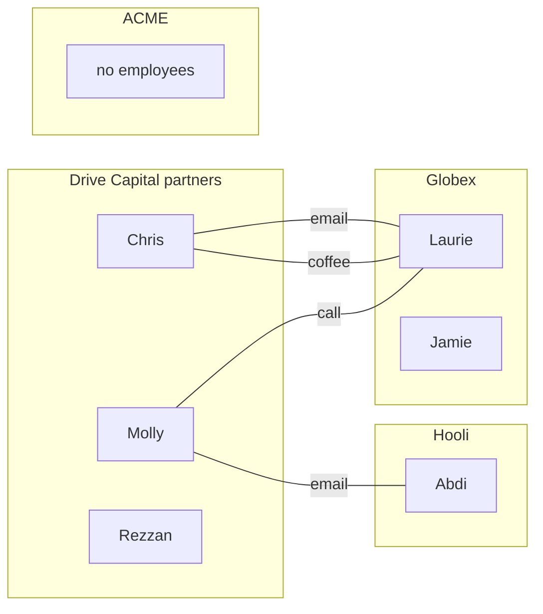

# Architecture

> Keep this file in sync with `src/`. If a module, type, or rule below no longer matches the code, update it in the same commit. The reasoning behind the bigger choices is in [`docs/decisions/`](./docs/decisions/).

## Folder structure

```text
src/
├── constants.ts        every constant: name pattern, contact types, keyword syntax, exit codes, limits
├── schemas/            Zod schemas; TypeScript types are inferred from them
│   ├── command.ts      the four input commands
│   └── options.ts      validated command-line options
├── core/               pure domain logic, no I/O
│   ├── parse.ts        line → command | error | skip
│   ├── network.ts      Network model, contacts counted at ingest
│   ├── analyze.ts      rank partners per company
│   ├── format.ts       text and JSON reports
│   ├── stats.ts        --stats summary (counts only)
│   └── pipeline.ts     lines → report + diagnostics
├── cli/                the only layer that touches process, files, and streams
│   ├── bin.ts          entry point for the `analyze-network` command
│   ├── main.ts         `main(io)`: reads input, writes output, returns the exit code
│   ├── args.ts         argv → validated options
│   ├── help.ts         --help text
│   ├── lines.ts        splits a stream into lines (\n, \r\n, or \r)
│   └── render.ts       warnings, notes, and color
└── utils/
    ├── suggest.ts      "did you mean" suggestions (edit distance)
    └── text.ts         small string helpers (list joining, name order)
analyze_network         runs src/cli/main.ts from source, no build (Node type stripping)
scripts/stress.ts       generates long, messy inputs plus a reference answer
scripts/demo.ts         `pnpm demo`: one labelled example of every flag
test/                   mirrors src/ (test/core/parse.test.ts, …), plus helpers/ and docs/ (runs the prompt's example)
examples/               the prompt's example and an edge-case file, each with expected output
└── scenarios/          31 small inputs (happy, unhappy, awkward) plus a 12,000-line stress file, each with expected output
docs/prompt.md          the take-home prompt, verbatim: the source of truth for requirements
docs/usage.md           every option, example output, and the full edge-case list
docs/development.md     tooling, hooks, CI, and stress testing
docs/decisions/         architecture decision records
```



Dependencies point one way: `cli → core → schemas → constants`, and any layer may use `utils`. `core` never imports from `cli`, so the whole domain can be tested without touching the filesystem.

## Data flow



In short: read one line at a time, parse it, apply it to the network, then rank and format once the input ends. Every step on the way to stdout is pure except reading and writing.

`core/pipeline.ts` runs parse → network → analyze over any iterable of lines and returns the report plus a `Diagnostic` for every skipped line: the line number, the line's text, the message, a `reason` code, the positions of the words at fault, and any notes found later in the file. It accepts an async iterable, so the CLI streams a file of any size through it, and tests pass a plain array.

## Modules

| File                     | Responsibility                                                                                                                                                                                                                                                                                                                                                                                                                                                                                                                                                                                                                                                                                                                                                                                         |
| ------------------------ | ------------------------------------------------------------------------------------------------------------------------------------------------------------------------------------------------------------------------------------------------------------------------------------------------------------------------------------------------------------------------------------------------------------------------------------------------------------------------------------------------------------------------------------------------------------------------------------------------------------------------------------------------------------------------------------------------------------------------------------------------------------------------------------------------------ |
| `src/constants.ts`       | Every constant: `NAME_PATTERN`, `CONTACT_TYPES`, `COMMAND_KINDS`, `COMMAND_SYNTAX` (keyword → fields and usage string), `KEYWORDS`, `BYTE_ORDER_MARK`, `COMMENT_PREFIX`, `NO_RELATIONSHIP`, `OUTPUT_FORMATS`, `EXIT_CODES` (`ok`, `inputProblem`, `usage`), `MAX_PRINTED_DIAGNOSTICS`, `STDIN_ARG`, `SUGGESTION_EDIT_LIMITS` and `SUGGESTION_MAX_EDITS` (how far off a word can be and still get a hint), and `SKIP_REASONS` (reason code → label) and `SKIP_REASON_CODES`                                                                                                                                                                                                                                                                                                                             |
| `src/schemas/command.ts` | Zod schemas for the four commands and `ContactType`. The `Command` union is inferred with `z.infer`, so types and runtime checks can't drift apart. Custom error messages turn Zod issues into plain-English warnings                                                                                                                                                                                                                                                                                                                                                                                                                                                                                                                                                                                  |
| `src/schemas/options.ts` | `CliOptionsSchema`: defaults for every flag, `--format` limited to `text` or `json`, `--company` names checked with the same letters-only rule as the input, and a non-empty file path                                                                                                                                                                                                                                                                                                                                                                                                                                                                                                                                                                                                                 |
| `src/core/parse.ts`      | `parseLine(line)` → `{ status: 'ok', command }`, `{ status: 'error', message, words }`, or `{ status: 'skip' }` for blank and `#` comment lines. `words` holds the positions of the words at fault. Checks the keyword and word count itself (so it can show the usage), then validates with `CommandSchema`. Never throws. `wordPositionOf(kind, field)` maps a command field to its word on the line                                                                                                                                                                                                                                                                                                                                                                                                 |
| `src/core/network.ts`    | `Network` class. `apply(command)` updates the model in input order and returns a `Problem` when a command refers to something undeclared or contradicts an earlier declaration: a message (with a "did you mean" hint where one fits), the `fields` at fault, and the `undeclared` names. Exposes `companies` and `strengthsFor(company)`. `counts` reports partners, companies, companies with contacts, employees, and contacts by type. `apply(command, { suggestNames: false })` skips the name lookups                                                                                                                                                                                                                                                                                            |
| `src/core/analyze.ts`    | `rankRelationships(network)` → `CompanyRelationships[]`: companies sorted by name, each with every partner who has contact, strongest first. `strongestPartner` picks the first. Keeping the full ranking costs little and powers `--format json`. `selectCompanies(report, names)` narrows the report for `--company` and lists missing names with every company each could mean (`possibleMatches`), so an ambiguous name is never resolved by guessing                                                                                                                                                                                                                                                                                                                                              |
| `src/core/format.ts`     | `formatLine` and `formatTextReport` render the prompt's `<Company>: <Partner> (<n>)` / `No current relationship` lines. `formatJsonReport` renders the same data as JSON: `company`, `partner` (or `null`), `strength`, and the full `partners` ranking. With `{ details: true }`, text lines list every partner: `Globex: Chris (2), Molly (1)`                                                                                                                                                                                                                                                                                                                                                                                                                                                       |
| `src/core/stats.ts`      | `summarize(result)` → `RunStats`: lines read, commands, skipped, and ignored; partners, companies (with and without a relationship), employees; contacts by type; skipped lines per reason, most common first. Counts only, never names                                                                                                                                                                                                                                                                                                                                                                                                                                                                                                                                                                |
| `src/core/pipeline.ts`   | `analyzeLines(lines, { strict })` → `{ report, diagnostics, commandCount, aborted }`. Keeps diagnostics that are waiting on an undeclared name; when that name is declared later, it adds a note with the line number. With `strict`, stops at the first diagnostic and returns an empty report. Also returns `lineCount`, `ignoredLineCount`, and the network's `counts` for `--stats`. Only the first `MAX_PRINTED_DIAGNOSTICS` (20) skipped lines keep full details and get "did you mean" lookups, since only they are ever printed; every skip is still counted in `skippedCount` and `skippedByReason`                                                                                                                                                                                           |
| `src/cli/bin.ts`         | The `bin` entry point: calls `runFromProcess()`. Kept apart from `main.ts` so importing `main.ts` never starts the CLI                                                                                                                                                                                                                                                                                                                                                                                                                                                                                                                                                                                                                                                                                 |
| `src/cli/main.ts`        | `main(io)`: the whole CLI as a function of injected streams, argv, and env, returning an exit code. Opens the input (checking for a missing file, a directory, or a permission problem first), streams it through the pipeline, and writes the report and diagnostics. A missing file gets a "did you mean" for a similar name in its folder. When stderr and stdout are both a terminal, a blank line separates the warnings from the report (stderr only, so redirected output is unchanged). `runFromProcess()` wires in the real `process` and exits quietly on `EPIPE`                                                                                                                                                                                                                            |
| `src/cli/args.ts`        | `parseCliArgs(argv)`: tokenizes with `node:util` `parseArgs`, shortens Node's error messages (suggesting the closest option for a typo), rejects extra positional arguments, and validates with `CliOptionsSchema`                                                                                                                                                                                                                                                                                                                                                                                                                                                                                                                                                                                     |
| `src/cli/help.ts`        | The `--help` text, built from `COMMAND_SYNTAX`, `OUTPUT_FORMATS`, and `EXIT_CODES` so it can't fall out of date                                                                                                                                                                                                                                                                                                                                                                                                                                                                                                                                                                                                                                                                                        |
| `src/cli/lines.ts`       | `readLines(stream)`: an async generator that splits any stream into lines, accepting `\n`, `\r\n`, and lone `\r` endings, even when a line, a `\r\n` pair, or a multi-byte character is split across chunks. Replaces `node:readline`'s async iterator, which throws "readline was closed" when one chunk holds more than about a thousand lines                                                                                                                                                                                                                                                                                                                                                                                                                                                       |
| `src/cli/render.ts`      | Compiler-style diagnostics: `warning: line N: …`, the line itself, a row of `^` under the words at fault (`underlineWords`), and `= note:` lines. Also the summary notes, the `MAX_PRINTED_DIAGNOSTICS` cap, and color via `node:util` `styleText`. `shouldUseColor` honors `--color`/`--no-color`, `NO_COLOR`, `FORCE_COLOR`, and whether stderr is a terminal. `excerpt` cuts lines longer than `MAX_EXCERPT_WIDTH` (100) around the words at fault. `renderStats` prints the `--stats` summary, one row per skip reason. Two layouts: `rich` (gutter, `^` markers, `= note:`) and `plain` (`line N reads: …`, `word at fault: …`, `note: …`, ASCII only). `chooseOutputStyle` picks the layout and color from `--plain`, `TERM=dumb`, `--[no-]color`, `NO_COLOR`, and `FORCE_COLOR`                 |
| `src/utils/suggest.ts`   | `suggest(word, candidates)` finds the closest candidate for a "did you mean" hint, ignoring case and allowing 0, 1, or 2 edits depending on word length (`SUGGESTION_EDIT_LIMITS`). `editDistance` counts insertions, deletions, replacements, and swapped neighbours, written as a short recursive function that remembers each answer it has worked out. Words over `MAX_SUGGESTION_LENGTH` (40) get no close-spelling hint, since the work grows with the two lengths multiplied. `didYouMean` formats the hint. `possibleMatches(word, candidates)` returns every candidate instead of one, for `--company`: names `word` is the start of (from `MIN_PREFIX_MATCH_LENGTH`, 3 letters) plus the closest spellings ignoring case, and `didYouMeanOneOf` lists up to `MAX_LISTED_MATCHES` (5) of them |
| `src/utils/text.ts`      | `formatList` (`a or b`, `a, b, or c`), `compareNames` (case-insensitive order with a code-unit tiebreak), `formatCount` (`1,234`), and `quote` (quotes a name for a message, shortening one over 40 characters)                                                                                                                                                                                                                                                                                                                                                                                                                                                                                                                                                                                        |

## Data model

```ts
partners: Set<string>;
companies: Set<string>;
employeeCompany: Map<employee, company>; // employee names are globally unique
strength: Map<company, Map<partner, number>>; // contacts per company/partner pair
```

A `Contact Laurie Chris email` looks up `employeeCompany.get("Laurie")` → `Globex` and increments `strength[Globex][Chris]`.

The prompt's example as a network. Each line is a contact; a partner's strength with a company is the number of lines between that partner and the company's employees:



| Company | Strength by partner | Output                          |
| ------- | ------------------- | ------------------------------- |
| ACME    | none                | `ACME: No current relationship` |
| Globex  | Chris 2, Molly 1    | `Globex: Chris (2)`             |
| Hooli   | Molly 1             | `Hooli: Molly (1)`              |

Rezzan is declared but has no contacts, so Rezzan never appears in the output.

### Why count at ingest

- Analysis becomes one pass over the counts, with no join between contacts and employees.
- Memory is O(companies × partners that contacted them) instead of O(contacts). Contacts are by far the largest part of a real network file.
- **Cost:** the per-contact detail (which employee, which type) is gone once counted. That's fine for this question. Questions like "who at ACME do we know?" or weighted contact types would need a raw contact log next to the counts (see ROADMAP).

## Validation

Parsing happens in two steps. `parse.ts` first checks the structure: is the first word a known keyword, and is the word count right? Those errors need the usage string, which Zod doesn't know about. Then the words go through `CommandSchema`, a Zod discriminated union, which checks that names are letters only and that the contact type is one of the three allowed values. All issues on a line are reported together, not only the first one.

Keywords and contact types are case-sensitive, as the prompt writes them. A near miss is still rejected, but the warning suggests the likely fix.

## Hints

Every warning tries to say how to fix the line, not just what's wrong with it, and marks the words at fault with `^`:

| Mistake                                                               | Example                                        | Hint                                                    |
| --------------------------------------------------------------------- | ---------------------------------------------- | ------------------------------------------------------- |
| Keyword typo or wrong case                                            | `Contcat`, `partner`                           | `did you mean "Contact"?`                               |
| Contact type typo or wrong case                                       | `cofee`, `Coffee`                              | `did you mean "coffee"?`                                |
| Undeclared employee, partner, or company with a similar declared name | `Lauri`, `Chriss`, `Globexx`                   | `did you mean "Laurie"?`                                |
| Employee and partner swapped in a `Contact`                           | `Contact Chris Sarah call`                     | `the order is Contact Sarah Chris call`                 |
| Name used before its declaration                                      | `Contact Peter Rezzan call` … `Partner Rezzan` | `"Rezzan" is declared later, on line 21`                |
| Unknown keyword with no close match                                   | `Investor`                                     | lists the four valid commands                           |
| Wrong number of words                                                 | `Employee Bob`                                 | shows the command's usage                               |
| Full name where one word belongs                                      | `Partner Chris Smith`                          | `did you mean "Partner ChrisSmith"?`                    |
| Partial or ambiguous `--company` name                                 | `Glob`, `acme`                                 | `did you mean "Globe" or "Globex"?`, every match listed |
| Mistyped option                                                       | `--detail`, `--colour`                         | `did you mean "--details"?`                             |
| Mistyped file name or missing extension                               | `examples/inptu.txt`, `examples/input`         | `did you mean "examples/input.txt"?`                    |

Suggestions use `suggest` in `src/utils/suggest.ts`: case is ignored, and the allowed number of edits grows with word length (none for 1–2 letters, one for 3–4, two for longer words), so short names don't get unrelated suggestions.

The comparison works from the end of both words: matching last letters cost nothing; otherwise it tries deleting, inserting, and replacing a letter (and swapping the last two, if that fits) and keeps the cheapest. Words longer than 40 letters skip it. Before that limit, a contact naming a 20,000-letter partner that differed from a declared one by a letter ran the tool out of memory; it now finishes in about 0.1 seconds.

Messages never let one huge input flood the terminal: a name longer than 40 characters is quoted by its ends and length (`"LongAAAA...AAA1" (5,005 characters)`, via `quote` in `src/utils/text.ts`), and an echoed line longer than 100 characters is cut to an excerpt around the words at fault, with `…` at each cut end (`...` in the plain layout).

## Rules

- **Strongest partner:** highest count; ties go to the alphabetically first partner name (same order as companies). Partners with no contact with a company aren't ranked for it.
- **Company order:** case-insensitive alphabetical, then ordinal comparison as a tiebreak so the order is fully deterministic.
- **Processing order:** commands apply in input order. A contact that refers to an employee or partner not yet declared is a warning, not a forward reference.

## Error handling

| Situation                                       | Behavior                                                                                                                                               | Exit code |
| ----------------------------------------------- | ------------------------------------------------------------------------------------------------------------------------------------------------------ | --------- |
| Malformed or invalid line                       | `warning: line N: …` and the line itself on stderr; line skipped                                                                                       | 0         |
| Unknown reference (employee, partner, company)  | Same as above                                                                                                                                          | 0         |
| Any invalid line with `--strict`                | `error: line N: …` on stderr; stops reading; no report                                                                                                 | 1         |
| Empty input or no companies                     | Empty report, `note:` on stderr explaining why                                                                                                         | 0         |
| No line was a valid command                     | Warnings plus a note asking whether it's the right file                                                                                                | 0         |
| More than 20 invalid lines                      | First 20 shown, then `…and N more warnings (add --stats to count them by reason)`                                                                      | 0         |
| `--company` name not in the input               | `error: company "…" isn't in the input`, with every company it could mean when any are close; the companies that were found are still printed          | 1         |
| File missing, a directory, or unreadable        | `error: cannot read "…": no such file` (or `it is a directory`, `permission denied`); a missing file gets a hint for a similar name in the same folder | 2         |
| Unknown option, bad `--format`, extra arguments | `error: …` plus a pointer to `--help`; a mistyped option gets a hint                                                                                   | 2         |
| No file and STDIN is a terminal                 | `error: no input …` instead of waiting for keyboard input                                                                                              | 2         |
| stdout closed early (`\| head -1`)              | Exits quietly                                                                                                                                          | 0         |

Diagnostics have a screen-reader-friendly `plain` layout (`--plain`, or automatically with `TERM=dumb`); see decision record 0008.

The stdout report never contains diagnostics or color codes, so `analyze-network file | …` is always safe to pipe. Warnings are colored only when stderr is a terminal, unless `NO_COLOR`, `FORCE_COLOR`, or `--[no-]color` says otherwise.

## Testing

| Level                 | Where                                                     | What it covers                                                                                                                                                                                                                                                       |
| --------------------- | --------------------------------------------------------- | -------------------------------------------------------------------------------------------------------------------------------------------------------------------------------------------------------------------------------------------------------------------- |
| Unit                  | `test/core/`, `test/schemas/`, `test/utils/`              | Each rule in isolation with plain values, including that `--stats` output never contains names                                                                                                                                                                       |
| CLI, in process       | `test/cli/main.test.ts`, `args.test.ts`, `render.test.ts` | `main(io)` with fake streams: golden output for both examples, STDIN, CRLF, every exit code, formats, color, `--company`, `--details`, `--stats`, `--plain` and `TERM=dumb`, file errors, option and file-name hints, the blank line before the report on a terminal |
| End to end            | `test/cli/e2e.test.ts`                                    | `src/cli/bin.ts` and `./analyze_network` in a child process: real pipes and process exit codes                                                                                                                                                                       |
| Scenarios             | `test/cli/scenarios.test.ts`                              | Every `examples/scenarios/*.txt` against its `.expected.txt` (stdout and exit code). New scenarios are picked up automatically                                                                                                                                       |
| Prompt                | `test/docs/prompt.test.ts`                                | The example in `docs/prompt.md`, read straight from the file and run exactly as written (comment line included), plus a check that `examples/input.txt` is the same example                                                                                          |
| Stress (differential) | `test/scripts/stress.test.ts`                             | The program against the independent reference model in `scripts/stress.ts`: 25 seeds of 2,000 contacts through the pipeline, and 200,000 contacts piped through the CLI. Checks the report, the skipped-line count, and the counted contacts                         |
| Demo                  | `test/scripts/demo.test.ts`                               | Every `pnpm demo` example still ends with the exit code it promises                                                                                                                                                                                                  |

The golden tests compare against `examples/*.expected.txt` and `examples/scenarios/*.expected.txt`, the same files a reviewer would use by hand. Their expected outputs were derived from the rules by hand, not captured from the tool, so they check behaviour rather than repeat it. `.gitattributes` keeps the example files byte-exact.

## Complexity

With L lines, C companies, and P partner/company pairs that have at least one contact:

- Ingest: O(L) time.
- Analysis: O(C log C + P log P), from sorting companies and ranking each company's partners.
- Memory: O(partners + companies + employees + P). Input is streamed, never held whole, and only the first 20 skipped lines keep their details; the rest are just counted, so a file full of bad lines doesn't grow memory.
- Hints: a "did you mean" lookup scans the declared names of one kind, skipping any whose length is too different, so it costs O(names). Only the first 20 problems get lookups, so a run does at most 20 of them however many lines are bad. (Before this limit, a stress test with 30,000 bad lines and 16,000 employees took 40 seconds; it now takes under half a second.)

## Tooling

- **TypeScript 7** (`tsconfig.json`): the `@tsconfig/node24` base (ES2024, `nodenext`) plus the Total TypeScript strictness set: `strict`, `noUncheckedIndexedAccess`, `exactOptionalPropertyTypes`, `noImplicitOverride`, `noImplicitReturns`, `noPropertyAccessFromIndexSignature`. `erasableSyntaxOnly` keeps `./analyze_network` and `node src/cli/bin.ts` working through Node's type stripping, so no enums or namespaces, and imports use `.ts` extensions that `tsc` rewrites to `.js`.
- **Zod 4** validates parsed commands and CLI options. It's the only runtime dependency; argument parsing (`parseArgs`) and color (`styleText`) come from Node itself, and lines are split by the small `readLines` in `src/cli/lines.ts`. Zod's error messages are customized so a bad line reads as plain English, e.g. `contact type "Coffee" is not valid (did you mean "coffee"?)`.
- **Vitest** for unit, in-process CLI, and end-to-end tests in `test/`.
- **oxlint** (`.oxlintrc.json`): `correctness` rules are errors; `suspicious` and `perf` are warnings. Plugins: eslint, typescript, unicorn, oxc, import, node, promise, vitest. Extra rules: `eqeqeq`, `consistent-type-imports`, `no-explicit-any`, `prefer-node-protocol`, `import/no-cycle`, and no focused tests. `pnpm lint` runs with `--deny-warnings`, so any warning fails `pnpm check`. Type-aware rules such as `no-floating-promises` would need `oxlint-tsgolint`, which isn't installed.
- **oxfmt** (`.oxfmtrc.json`): Prettier-compatible settings at an 80-column width, LF line endings, sorted imports, and sorted `package.json`.
- **pnpm** as the package manager.
