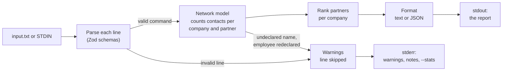

# Drive Capital Network Analyzer

[](https://github.com/CMSOTO2/drive-capital-network/actions/workflows/ci.yml)

Reads Herbie's network file and prints, for each company, the Drive Capital partner with the strongest relationship to it.

```console
$ ./analyze_network examples/input.txt
ACME: No current relationship
Globex: Chris (2)
Hooli: Molly (1)
```

**Contents:** [Run it](#run-it) · [Requirements checklist](#requirements-checklist) · [How it works](#how-it-works) · [Assumptions and edge cases](#assumptions-and-edge-cases) · [How I used LLMs](#how-i-used-llms) · [What was challenging](#what-was-challenging) · [More docs](#more-docs)

## Run it

Needs **Node 22.18+** and **pnpm 10**. There's no build step.

```bash
pnpm install
./analyze_network examples/input.txt          # from a file
cat examples/input.txt | ./analyze_network    # from STDIN
pnpm test                                     # run the tests
```

On Windows, use `node analyze_network examples/input.txt`. To build instead, `pnpm build` compiles to `dist/`, then run `node dist/cli/bin.js <file>`.

A few things to try:

```bash
./analyze_network examples/edge-cases.txt                        # bad lines: warnings on stderr, the report still prints
./analyze_network --company Globex --details examples/input.txt  # one company, with every partner's strength
./analyze_network --format json examples/input.txt              # JSON for scripts
./analyze_network --help                                         # every option
```

[`examples/scenarios/`](./examples/scenarios/) has 31 more inputs, each with its expected output: happy paths, common mistakes, and awkward files.

## Requirements checklist

Each requirement in [the prompt](./docs/prompt.md) and where it's handled:

- [x] **Four commands, one per line, words made of letters:** [`src/core/parse.ts`](./src/core/parse.ts), validated by the Zod schemas in [`src/schemas/`](./src/schemas/)
- [x] **Employees work at a declared company, and names are globally unique:** [`src/core/network.ts`](./src/core/network.ts)
- [x] **Only `email`, `call`, and `coffee` are accepted:** anything else gets a warning
- [x] **Run from the command line with a file or STDIN:** [Run it](#run-it)
- [x] **Every company, alphabetically, with its strongest partner:** [`src/core/analyze.ts`](./src/core/analyze.ts)
- [x] **Strength is the total contacts with all of the company's employees:** counted in [`src/core/network.ts`](./src/core/network.ts)
- [x] **Exact output format, including `No current relationship`:** [`src/core/format.ts`](./src/core/format.ts)
- [x] **The example gives the expected output:** [`test/docs/prompt.test.ts`](./test/docs/prompt.test.ts) runs it straight from the prompt
- [x] **README with run and test steps, approach, LLM use, and assumptions:** this page

## How it works



1. **Parse.** Each line is checked and turned into one of the four commands.
2. **Count.** Valid commands update an in-memory network. A contact adds 1 to its company and partner pair right away.
3. **Report.** At the end, companies are sorted, each company's partners are ranked, and the top one is printed.

The core logic is under 500 lines in [`src/core/`](./src/core/): `parse.ts` → `network.ts` → `analyze.ts` → `format.ts`. Everything in `src/cli/` is the command-line wrapper around it. The core never touches files or the terminal, so every rule is tested with plain strings.

**Key decisions** (each has a one-page record in [`docs/decisions/`](./docs/decisions/)):

- **Count contacts as they're read** instead of storing them. Memory grows with company and partner pairs, not with contacts. The cost is that per-contact detail isn't kept, which questions like "who do we know at ACME?" would need ([ROADMAP.md](./ROADMAP.md)).
- **Warn and skip bad lines by default.** One bad line shouldn't hide the answer for every other company. `--strict` fails instead, for pipelines that prefer that.
- **Fixed rules for ties and ordering**, so the same input always gives the same output.
- **Validate input with Zod.** The TypeScript types come from the schemas, so the types and the runtime checks can't drift apart.
- **TypeScript, as a CLI.** TypeScript is my strongest language. The input is a file and the output is text people pipe and script, so the effort went into the command line rather than a web UI.

## Assumptions and edge cases

Where the prompt is silent or unclear, this is what I decided:

| Question                                       | Decision                                                                                                        |
| ---------------------------------------------- | --------------------------------------------------------------------------------------------------------------- |
| Two partners tie for strongest                 | The alphabetically first one wins                                                                               |
| "Sorted alphabetically" with mixed case        | Ignore case (`ACME`, `apple`, `Globex`); on an exact tie, uppercase comes first                                 |
| "Characters A thru z"                          | The letters A–Z and a–z only, not the ASCII symbols between `Z` and `a` (`[`, `\`, `_`, …)                      |
| Contact types                                  | Only `email`, `call`, `coffee`. Each contact counts as 1, with no weighting                                     |
| A name used before it's declared               | Warning, line skipped, since input is processed in order. The warning points to the line that declares it later |
| An employee declared at a second company       | Warning; the first company is kept, since employee names are globally unique                                    |
| The same `Contact` line twice                  | Both count; they're separate interactions                                                                       |
| A partner or company declared twice            | Ignored                                                                                                         |
| Invalid lines (the prompt says there are none) | Warning and skip; `--strict` fails instead                                                                      |
| Lines starting with `#`                        | Comments. Real input won't have them, but the prompt's example does                                             |
| A partner with no contacts                     | Never printed                                                                                                   |
| A partner and an employee with the same name   | Allowed; they're separate                                                                                       |

It also handles messy files: Windows and old Mac line endings, a byte order mark, tabs and extra spaces, a missing final newline, and empty files. Typos get "did you mean" hints, and a million contacts run in about 2 seconds. The [full edge-case list](./docs/usage.md#every-edge-case) has every case.

## How I used LLMs

I used Claude Code throughout, and treated its output like a teammate's work.

- **Planning:** I gave it the prompt and asked for a plan before any code. It proposed the pipeline, the data model, and the edge-case rules, and I approved the plan before any code was written.
- **Code and tests:** it implemented each phase as small commits, with tests alongside the code. I directed the work: the folder layout, Zod for validation, rewriting dense code to read plainly, and pushing on user experience and accessibility.
- **Tooling and docs:** it set up TypeScript, the linters, git hooks, and CI, and drafted this README and the other docs. A rule in [CLAUDE.md](./CLAUDE.md) makes docs change in the same commit as the code they describe.
- **Product questions:** I used it as a sounding board. When I asked about a web UI, it argued for putting the effort into the CLI. When I asked for analytics, it pointed out that sending usage data from a tool full of people's names is a privacy problem, so we built local `--stats` instead. I agreed with both calls.
- **Verification:** it checked its claims rather than asserting them. For example, Node 22 support was proven by running the whole test suite on Node 22.
- **Where it slipped:** twice, a script that edited the docs stopped partway, and the commit went in with half-updated docs. It caught both on review and fixed them before anything was pushed. That's why docs and code are now checked together on every commit.

## What was challenging

- **Reading between the lines of the spec.** Most of the work was deciding what to do where the prompt is silent: ties, names used before they're declared, bad contact types, the `#` comment in the example. I treated each as a product decision, picked something deterministic, and wrote it down.
- **Leniency versus correctness.** Skipping bad lines is friendlier, but a silently wrong answer is worse than a crash. So every skipped line is reported with its line number and a summary, and `--strict` is there for callers that would rather fail.
- **Helpful error messages.** Zod's default messages are written for developers. Turning them into `contact type "Coffee" is not valid (did you mean "coffee"?)` meant checking the line's structure before Zod and customizing its messages.
- **Analytics without surveillance.** The input is people's names and who talked to whom. Users get the numbers locally (`--stats`, counts only), and [a decision record](./docs/decisions/0007-usage-telemetry.md) sets the rules any future telemetry would have to follow.

## More docs

- [**Usage guide**](./docs/usage.md): every option, example output, exit codes, accessibility, and the full edge-case list
- [**ARCHITECTURE.md**](./ARCHITECTURE.md): modules, diagrams of the data flow and data model, error handling, and testing
- [**Development**](./docs/development.md): tests, linting, git hooks, CI, and stress testing
- [**Decision records**](./docs/decisions/): the reasoning behind each major choice
- [**ROADMAP.md**](./ROADMAP.md): what I'd build next, such as "who do we know at ACME?" and weighting coffee above email
- [**The prompt**](./docs/prompt.md), verbatim
